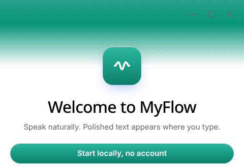
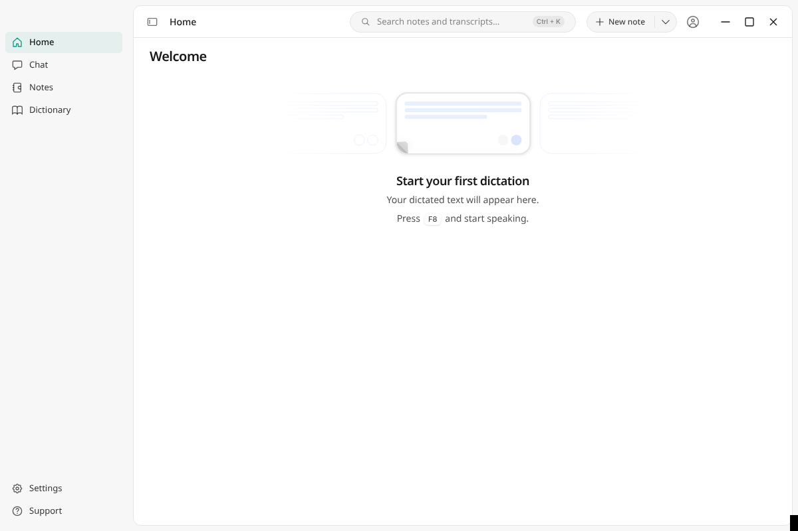

<p align="center">
  
</p>

<h1 align="center">MyFlow</h1>

<p align="center">
  Aperte um atalho em qualquer app, fale naturalmente e o texto aparece pronto onde você está digitando.<br/>
  Selecione um trecho e reescreva-o por voz. Tudo roda no seu computador.
</p>

<p align="center">
  
</p>

---

MyFlow é um app de ditado para desktop no estilo Wispr Flow, construído sobre o
[OpenWhispr](https://github.com/OpenWhispr/openwhispr) (licença MIT). Ele mantém todo o
motor do OpenWhispr e muda a marca, deixa a interface mais enxuta e vem configurado
para funcionar **localmente, sem conta e sem nuvem**.

## O que ele faz

| Ação                   | Atalho padrão                                                                                                | O que acontece                                                                                                                                                                                  |
| ---------------------- | ------------------------------------------------------------------------------------------------------------ | ----------------------------------------------------------------------------------------------------------------------------------------------------------------------------------------------- |
| Ditado                 | `Option` direito no macOS, `Ctrl+Super` no Windows/Linux (o assistente inicial deixa você trocar, ex.: `F8`) | Grava enquanto você fala; o texto é transcrito, polido (pontuação, sem "hã/éé", números formatados) e colado no campo em foco.                                                                  |
| Editar seleção por voz | `Ctrl+Shift+Space`                                                                                           | Selecione um texto, aperte o atalho e diga, por exemplo, "deixe mais formal" ou "traduza para inglês". O trecho é substituído no lugar. Sem seleção, o comando vai para o painel do assistente. |
| Cancelar               | `Esc`                                                                                                        | Cancela a gravação em andamento.                                                                                                                                                                |

Os atalhos podem ser trocados em **Settings → Hotkeys**.

### Modo rápido

Por padrão, o ditado não passa pela IA: o texto sai do Orukeet já com pontuação, e um
filtro instantâneo remove hesitações ("hã", "ahn", "uh", "hmm"). Do soltar do atalho
ao texto colado leva cerca de 1 segundo. Para a limpeza completa por IA ("modo
caprichado"), ligue **Settings → AI Models → Ativar limpeza de texto**; o modelo local
continua sendo usado na edição de seleção por voz.

### 100% local por padrão

- **Transcrição:** Orukeet (≈670 MB, 25 idiomas incluindo português e inglês, detecção automática), executado pelo sherpa-onnx na CPU. Whisper (whisper.cpp) e NVIDIA Parakeet também estão disponíveis em Settings.
- **Edição por voz (e limpeza, se ligada):** um LLM local via llama.cpp. O MyFlow escolhe o tamanho pela memória da máquina: 24 GB+ → Qwen3.5 9B, 14 GB+ → Qwen3.5 4B, 7 GB+ → Qwen3.5 2B, menos → LFM2.5 1.2B (com 3 núcleos ou menos ele desce um nível). Dá para trocar no onboarding ou em **Settings → AI Models**.
- Nenhum áudio ou texto sai do seu computador. O login no OpenWhispr Cloud (serviço de terceiros) fica oculto, a não ser que o build seja feito com `VITE_OPENWHISPR_API_URL`.

<p align="center">
  
</p>

## Como baixar e abrir

Os instaladores são gerados pelo GitHub Actions (`.github/workflows/build.yml`) para
Windows, macOS e Linux. Eles **não são assinados**, então o sistema mostra um aviso na
primeira abertura.

1. Abra a aba **Actions** deste repositório, entre no último run verde de **Build MyFlow** e baixe o artefato do seu sistema. Se você criar uma tag `v*` (ex.: `git tag v1.11.0 && git push --tags`), os arquivos também vão para a aba **Releases**.
2. Instale e abra:

**Windows:** rode `MyFlow Setup <versão>.exe`. Se aparecer "O Windows protegeu o computador", clique em **Mais informações → Executar assim mesmo**.

**macOS:** abra o `.dmg` e arraste o MyFlow para Aplicativos. Na primeira vez, clique com o botão direito no app e escolha **Abrir**, porque ele não é notarizado. Depois libere **Microfone** e **Acessibilidade** em Ajustes do Sistema → Privacidade e Segurança.

**Linux (AppImage):**

```bash
chmod +x MyFlow-*-linux-x86_64.AppImage
```

```bash
./MyFlow-*-linux-x86_64.AppImage
```

**Linux (Debian/Ubuntu):**

```bash
sudo apt install ./MyFlow-*-linux-amd64.deb
```

No Linux, a colagem automática precisa de `xdotool` (X11) ou de `wtype`/`ydotool` (Wayland):

```bash
sudo apt install xdotool wl-clipboard
```

3. No primeiro uso, clique em **Start locally, no account**, permita o microfone, escolha os atalhos e baixe os modelos recomendados (cerca de 0,7 GB de transcrição + 1 a 6 GB de IA, conforme a sua máquina).

## Rodar a partir do código

Requer Node.js 24.

```bash
git clone https://github.com/GustavoLeitao07/myflow.git
```

```bash
cd myflow && npm ci
```

```bash
npm run dev
```

Para gerar instaladores localmente: `npm run build:linux`, `npm run build:win` ou
`npm run build:mac` (cada um no próprio sistema). Os scripts `prebuild:*` baixam
whisper.cpp, llama.cpp e sherpa-onnx dos releases públicos no GitHub.

## O que mudou em relação ao OpenWhispr

- Nome, ícones, logo, paleta (verde-azulado) e textos em 11 idiomas.
- Tela inicial: o padrão é "começar localmente, sem conta". As opções de nuvem só aparecem em builds configurados para ela.
- Modo local recomendado no onboarding, com pré-seleção do modelo de IA pela memória da máquina (`src/helpers/myflowHardware.js`).
- O atalho de edição por voz também é configurado no onboarding sem conta.
- Barra lateral só com o essencial (Home, Chat, Notes, Dictionary). Sem banners de upgrade nem cartão de calendário para quem usa localmente.
- Atualização automática aponta para os releases deste repositório.
- Correções:
  - **X11:** editar uma seleção em apps GTK (gedit etc.) falhava, porque a escrita na área de transferência pelo Chromium também toma a seleção PRIMARY e o app desmarca o texto. Agora o MyFlow usa `xclip`/`xsel` nesse caminho.
  - **Onboarding:** quando o modelo de transcrição já estava baixado, "Proceed" não salvava a escolha e o primeiro ditado falhava.

## Licença e créditos

MIT. O arquivo [`LICENSE`](LICENSE) original do OpenWhispr foi mantido sem alterações e
vale para o projeto inteiro. Veja [`NOTICE.md`](NOTICE.md). O MyFlow é um projeto
independente, sem afiliação com o OpenWhispr nem com a Gizmo Labs. Agradecimentos ao
OpenWhispr, whisper.cpp, llama.cpp, sherpa-onnx, NVIDIA Parakeet, Oruk/Orukeet, Qwen,
Electron e React.
